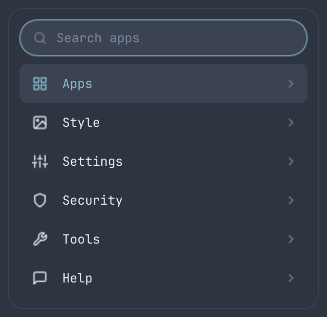
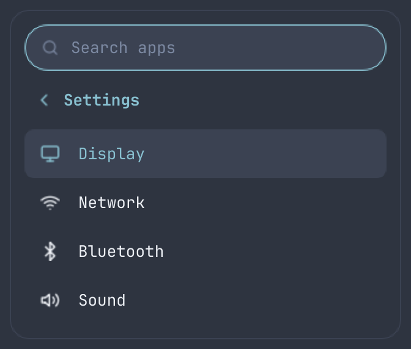
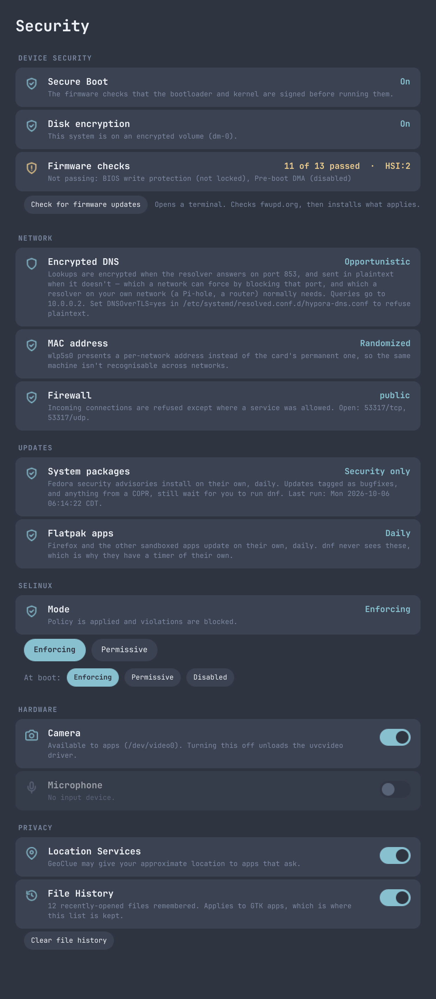
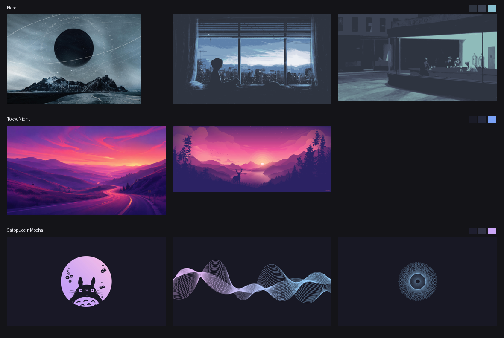

# Reference

The detail behind the [readme](../readme.md): what is incomplete, requirements, installing, everything Hypora ships, the keys, and how the repository is laid out.

[← back to the readme](../readme.md)

## Alpha: what's incomplete

> **Hypora is alpha software.** The majority of it works — the installer, the shell, the login screen, theming, and the Security, Display, Network, Bluetooth and Sound windows have all been exercised on real hardware. But **some sections are incomplete and there are known bugs**, and you should expect to hit them.
>
> Known-incomplete and under investigation:
>
> - **Boot** — the GRUB framebuffer leftover (a black box after menu selection, and the menu reappearing after the splash) is still being chased; `fbcon=nodefer` is the current fix and is not yet confirmed on hardware
> - **Battery** — on at least one ThinkPad the embedded controller's gauge reports 100% while discharging. This is a firmware reading, not Hypora's arithmetic, but the bar shows what it is given
> - **Boot time** is longer than it should be and hasn't been profiled yet
> - **Not yet run end to end:** `hypora-power install`. Fingerprint enrolment has been tried: on a ThinkPad whose Synaptics reader libfprint cannot drive, which is now detected and reported instead of offered `hypora-replace-de` has now been run on real hardware, which is how its missing cleanup phase and a silent keyring-auto-unlock breakage were found — both fixed
> - **Packaging** — `packages/*.txt` and a modular `install/` directory are planned, not written
> - **Theming** — TokyoNight's `dim` colour sits at 2.76 contrast, just under the 3.0 floor the other themes meet
>
> Most development happened in a VM. It has since been installed and booted on bare metal, but hardware-specific pieces (GPU, battery, backlight) have had far less exercise than the rest. Please [file what you find](../readme.md#reporting-bugs).

## Requirements

Hypora is built and tested against one baseline, and everything below works on it:

> **Fedora Everything netinstall**, with **"Encrypt my data" ticked** and **btrfs** as the filesystem.

None of the three is enforced — the installer runs on a stock Workstation install on ext4 without encryption and most of it works fine. But each one you skip takes a feature with it, and two cannot be added later without reinstalling:

| Choice | What you get | If you skip it |
|---|---|---|
| **Everything netinstall** | a base with no second desktop competing for the session | you are carrying two desktops. Hypora disables GDM and uses its own session, and `hypora-replace-de` can remove the other one's session, its leftover packages and their orphaned libraries — see [Replacing another desktop](desktop.md#replacing-another-desktop) |
| **Encrypt my data** (LUKS) | full-disk encryption, and a themed passphrase prompt at boot | the disk is readable by anyone holding it. **Cannot be added later** — LUKS is set up as the partitions are created |
| **btrfs** | snapshots via snapper (with the btrfs-assistant GUI), one before every unattended update, plus scheduled scrub and balance | no snapshots and no scrub, so bit rot goes unnoticed. **Cannot be converted later** in any way worth attempting on a system you care about |

The installer checks these at the start, tells you which you are missing, and carries on.

Also needed:

- A fresh **Fedora** install (tested on Fedora 44), an internet connection, and a user with `sudo`
- **Hyprland 0.55 or newer** — the config is Lua (`hyprland.lua`), which replaces the deprecated `hyprland.conf` format
- A Quickshell build with the PipeWire, system tray, notifications, UPower and polkit modules. The installer enables COPRs if the packages aren't in the main repos
- **The SSH server is switched off** and port 22 closed. Why, and how to keep it: [Network exposure](security.md#network-exposure)

## Installing in detail

Two ways to get the files. Either works; the difference is only which revision you end up on.

**Download a release** — a fixed set of files that was tested as a unit. On alpha this is the one to pick if you want to be able to say *which* Hypora you are reporting a bug against. Grab the source tarball from the [releases page](https://github.com/misfitxtm/Hypora/releases), or:

```bash
mkdir -p ~/.local/share/hypora
curl -fsSL https://github.com/misfitxtm/Hypora/archive/refs/tags/v0.1.0-alpha.tar.gz \
  | tar xz --strip-components=1 -C ~/.local/share/hypora
cd ~/.local/share/hypora
./install.sh
```

**Clone the repository** — tracks `main`, so you get fixes as they land, which during alpha is most days. Also what you want if you intend to read or change the code, since you keep the history:

```bash
git clone https://github.com/misfitxtm/Hypora.git ~/.local/share/hypora
cd ~/.local/share/hypora
./install.sh
```

Pick a theme with the `THEME` variable (it must exist under `themes/`). Re-runs keep the theme you last chose with `hypora-theme`:

```bash
THEME=TokyoNight ./install.sh
```

The installer is safe to re-run. It:

1. Checks you're on Fedora and not running as root, and whether this is a laptop or a desktop — the battery and backlight pieces only install on a laptop
2. Enables the `sdegler/hyprland` COPR (Fedora doesn't package Hyprland or uwsm) and checks Hyprland is 0.55+
3. Installs required packages, warning and continuing if an optional one is unavailable: PipeWire with wiremix, BlueZ, tuned-ppd, zsh, Neovim, fastfetch, and, only if you say yes when asked (or set `INSTALL_EXTRAS=yes`), `@virtualization` (libvirt, QEMU/KVM, virt-manager) and network tools (nmap, aircrack-ng, wireshark/tshark)
4. Installs Oh My Zsh and the LazyVim starter, both pinned to a commit, and makes zsh your login shell (an existing `~/.config/nvim` is left alone)
5. Installs JetBrainsMono Nerd Font and the system font defaults
6. Enables NetworkManager, upower, bluetooth and power profiles; points DNS at systemd-resolved with DNS-over-TLS; randomizes MAC addresses; enables `firewalld` in the closed `public` zone; turns on automatic security updates for packages and flatpaks; sets up keyring auto-unlock; and sets the default boot target to graphical
7. Installs the theme palettes and templates into `~/.config/hypora/` and applies the chosen theme
8. **Copies** `config/hypr/hyprland.lua`, `config/quickshell/`, the GTK settings and the themes into `~/.config/`, and `applications/*.desktop` into `~/.local/share/applications/`
9. Installs the SDDM login theme, disables GDM/LightDM/greetd, enables SDDM, and installs the Plymouth boot theme — the slowest step, because it rebuilds the initramfs
10. Copies `bin/` into `~/.local/bin/`, except the root-owned helpers, which go to `/usr/local/bin`
11. Checks hardware, firmware and drivers (see [Hardware](hardware.md))
12. On btrfs, sets up snapper, btrfs-assistant and btrfsmaintenance (see [Snapshots](storage.md#snapshots))
13. Offers to remove another desktop if one is installed — session, leftovers and orphans, keeping what Hypora is built on — then **offers RPM Fusion**, then **offers Claude Code**. All three default to no, and all three are at the end of the run so a declined answer costs nothing

Anything it replaces that you had changed is saved as `<name>.bak.<timestamp>`.

Configs are **copies**, so the directory you installed from can be moved or deleted afterwards. To update, `git pull` (or download a newer release over the same directory) and re-run `./install.sh`: it records a checksum of every file it installs, so files you haven't touched are updated quietly, files you edited are saved as `<name>.bak.<timestamp>` before being replaced, and files Hypora no longer ships are removed (unless you edited them). Quickshell live-reloads when you edit `~/.config/quickshell/*.qml`.

### Starting the desktop

Reboot. SDDM shows the Hypora login screen and starts the **Hyprland (uwsm-managed)** session. On machines with more than one user, the name appears above the box.

Without the login screen, start it from a text console with `uwsm start hyprland-uwsm.desktop` (or `start-hyprland`). Quickshell starts from the `hyprland.start` hook in `hyprland.lua` either way.

## What you get

**Desktop**

- A minimal SDDM login screen: the time, the date and a password field, in the active theme's colours
- Hyprland, started through `uwsm`
- Quickshell as the shell layer — it replaces Waybar, Mako *and* a standalone polkit agent

**Quickshell components** (`config/quickshell/`)

| Component | What it does |
|---|---|
| Bar (`Bar.qml`) | Top bar on every monitor: menu button, that monitor's own workspaces, clock, tray and status icons. See [Workspaces and monitors](desktop.md#workspaces-and-monitors) |
| Menu (`AppMenu.qml`, `AppMenuPanel.qml`) | From the Hypora logo at the top left. Six sections: **Apps**, **Style**, **Settings** (Hypora's own windows, not the system's control panels), **Security**, **Tools** — including **Set up fingerprint**, shown only when `fprintd` reports a device it can actually drive — a reader being present is a different question from libfprint having a driver for it, and several ThinkPad parts have none — and **Help**, with Keybindings and **Report a bug**. Enter or Right opens a section, Esc or Left goes back, typing searches apps. Power actions live in the control center |
| Security & Privacy (`SecuritySettings.qml`) | Secure Boot, disk encryption, firmware, firewall, DNS, updates, and the camera, microphone and location switches. Full description in [The Security and Privacy window](security.md#the-security-and-privacy-window) |
| Volume and brightness slider (`Osd.qml`) | Appears along the bottom of the focused monitor on a volume or brightness key, and leaves after a second and a half. Volume is a watched PipeWire property, so it also appears when the bar or control center changes it; brightness is pushed from the keybind instead, because the kernel exposes it as a sysfs file and sysfs raises no reliable change event. **Brightness is only wired up where there is a backlight** — a desktop has an empty `/sys/class/backlight`, and a slider that cannot move is worse than none. It takes no keyboard focus and clicks pass through it |
| Keyboard shortcuts (`KeybindHelp.qml`) | Menu > Help > Keybindings: every shortcut, grouped; click one and press the new combination to rebind it. **Your shortcuts are paused while it waits**, via the `keyboard-shortcuts-inhibit` protocol — Hyprland handles binds before any client sees the key, so otherwise SUPER + Q to rebind "Close window" would just close the window. Because the inhibition belongs to the window, nothing can leave you with a desktop that has no working keys, and the prompt turns amber if the compositor didn't agree. A chord already in use is **accepted**, not refused, with a banner naming the clash — refusing it made swapping two shortcuts impossible. Changes go to `~/.config/hypr/keybinds.lua`; delete it or use **Reset all** for stock |
| Theme picker (`ThemePicker.qml`) | **SUPER + ALT + T**: a full-screen carousel, each card a live preview — the theme's own wallpaper under a miniature desktop drawn in its colours, plus its palette. Arrows or scroll to slide, Enter to apply, Esc to close, type to filter |
| Wallpaper (`Wallpaper.qml`) | Cross-fades the wallpaper on every monitor. Each theme ships several; cycle with menu > Style > **Next wallpaper** (or `qs ipc call wallpaper next`). Your choice is remembered |
| Weather (`Weather.qml`) | Current conditions and a three-day forecast, right of the clock. You pick the city by name — no IP geolocation, and nothing requested until you choose. Data from [Open-Meteo](https://open-meteo.com), which needs no account or API key; `bin/hypora-weather` does the lookups and can be run on its own |
| Sound (`AudioSettings.qml`) | Output and input devices with their own volume and mute, a picker when there's more than one, and a row per playing application. Talks to PipeWire through Quickshell — no pavucontrol. `wiremix` is behind "Advanced" for routing and profiles |
| Default Apps (`DefaultApps.qml`) | Menu > Settings > Default Apps: which app opens each common file type, with the apps that declare the type first and **Show all apps** for the rest. **Add a file type** takes any extension — `.qml` in Neovim, say — and an extension nothing claims gets a small MIME type of its own in `~/.local/share/mime`. Defaults belong to MIME types, so each row says which other extensions a choice also changes. Writes only `~/.config/mimeapps.list`, the file Files, Firefox and `xdg-open` all read, through `bin/hypora-defaults` — no password. Terminal apps open in kitty via `xdg-terminal-exec` |
| Control center (`ControlCenter.qml`, `ControlPanel.qml`) | Click the status icons at the top right: Lock / Log out / Restart / Power off (the last three ask for a second click), volume and brightness, power mode (Saver / Balanced / Performance — see [Power](power.md)), and Wi-Fi, Bluetooth, Do Not Disturb and Night Light tiles |
| Network (`NetworkSettings.qml`, `Network.qml`) | Wi-Fi on/off, nearby networks with signal strength, connect (asking for a password when it's a new secured network), disconnect and forget. No terminal needed. The bar icon updates live via `nmcli monitor` |
| Bluetooth (`BluetoothSettings.qml`) | Power and scanning, pair, connect, disconnect and forget, with device battery where reported |
| Display (`DisplaySettings.qml`) | Resolution, refresh rate, scale, rotation and on/off per monitor. **Arrangement is set by dragging** a screen on the map — edges snap together, overlaps are refused, and the layout is anchored at 0,0. **Main display** is a toggle: that screen starts focused and Hypora's menu and clipboard open there, instead of on whichever output Quickshell enumerated first. Changes apply live, then a prompt appears **on every monitor** asking whether to keep them, reverting after 15 seconds — on every screen because a bad mode can hide the window holding the undo. Enter keeps, Esc reverts; kept settings go to `~/.config/hypr/monitors.lua` |
| Battery (`Battery.qml`, `BatteryWatch.qml`) | Charge in the bar on laptops, red when low. Notifies at 20% and 10% and suspends at 5%, because a laptop that runs flat mid-write is how filesystems get damaged. Each threshold fires once per discharge; plugging in resets them |
| Clipboard (`Clipboard.qml`) | History left of the clock, also on **SUPER + SHIFT + V**: click a recent copy to put it back, or Clear to wipe it. Recorded by `wl-paste --watch cliphist store`, since Quickshell doesn't speak `wlr-data-control` |
| Clock and calendar (`Clock.qml`, `CalendarPanel.qml`) | Click the clock: time, date and a month calendar. Arrows or scrolling change the month; click the month name to jump back to today |
| System usage (`SystemUsage.qml`, `SysInfo.qml`) | Live RAM, CPU, CPU temperature and, where reported, GPU usage and temperature, warming to the accent colour and then red as they climb. Click to choose which appear; numbers come from `bin/hypora-sysinfo` |
| Notifications (`Notifications.qml`) | Quickshell *is* the notification daemon: popups top-right, auto-expire, critical ones persist, action buttons supported |
| Launcher (`Launcher.qml`) | **SUPER + R**: type to filter, Tab or arrows to select, Enter to launch, Esc to close. Everyday apps only — control panels (anything in the freedesktop `Settings` category) live under the menu's Settings section |
| Plugins (`BarPlugins.qml`) | A slot in each part of the bar for items other people write, loaded from `~/.config/hypora/plugins.json`. Install one with `hypora-install-plugin` from a cloned plugin repository; you are shown every file and script, and asked, first. See [Plugins](plugins.md) |
| Tray, Volume, Icons, Polkit | System tray with left / middle / right click actions (`Tray.qml`), scrollable volume icon (`Volume.qml`), inline-SVG line icons and logo drawn in the theme's colours so no icon font is needed (`Icon.qml`, `Logo.qml`), and a full-screen polkit prompt that works with `pkexec` and anything else (`PolkitDialog.qml`) |

The shell is never run as root. Why, and which helpers are root-owned: [The Security and Privacy window](security.md#the-security-and-privacy-window).

**Terminal tools** — `nmtui` (Network > Advanced), `bluetoothctl` (Bluetooth > Advanced) and `wiremix` (Sound > Advanced). All three ship with Fedora, so nothing extra is downloaded for them.

**Fonts and icons** — **JetBrainsMono Nerd Font** for monospace and the shell UI, **Liberation Sans / Serif** for the rest, set system-wide in `/etc/fonts/conf.d/50-hypora.conf`; **Papirus-Dark** icons, with GTK and gsettings set to match.

**Shell, editor and fetch**

- **zsh** with **Oh My Zsh**, tab completion (menu select, case-insensitive), autosuggestions and syntax highlighting. Set as your login shell; put your own additions in `~/.zshrc.local`, which Hypora never overwrites
- **eza** replaces `ls` (`ls`, `ll`, `la`, and `lt` for a two-level tree), with **file-type icons** from the bundled Nerd Font and **coloured from the active theme** rather than from eza's own palette: `hypora-theme` renders `EZA_COLORS` from the same `colors.toml` as everything else, so a listing matches the desktop and changes with it. Permission bits, sizes, owners and dates are each coloured by meaning. `\ls` still gets you coreutils, and if `eza` is missing the plain `ls` aliases stay
- **Neovim** with the **LazyVim** starter, its colorscheme following the active theme (`~/.config/nvim/lua/plugins/hypora.lua` is the only file Hypora owns there)
- **fastfetch** with a Hypora logo and a short readout: OS (as *Hypora Linux*, with the running kernel), host, CPU, GPU, RAM, WM, terminal, the active theme and the palette. Set `HYPORA_NO_FETCH=1` to stop it greeting new shells

**Desktop applications** — a handful of GNOME's apps without the GNOME session; none of them pull `gnome-shell`, `mutter`, `gnome-session` or `gdm`: Files (`nautilus`, with `gvfs` for trash, mounts and network shares), Calculator (`gnome-calculator`), Disks (`gnome-disk-utility`), Software (`gnome-software`, which manages flatpaks — use `dnf` for system packages), Calendar (`gnome-calendar`), Disk Usage Analyzer (`baobab`), Document Viewer (`papers`, or `evince` before Fedora's rename) and Document Scanner (`simple-scan`).

These are kept deliberately and **marked user-installed**, which is what stops `dnf autoremove` and [`hypora-replace-de`](desktop.md#replacing-another-desktop) treating them as GNOME leftovers. GNOME Help (`yelp`) is removed instead: it documents a shell that isn't running.

**Virtualization and network tools** (asked about first; `INSTALL_EXTRAS=yes` or `no` answers ahead of time, and a machine that already has libvirt keeps it) — `@virtualization` (libvirt, QEMU/KVM, virt-manager) with `libvirtd` enabled and your user in the `libvirt` group, plus `nmap`, `aircrack-ng` and `wireshark`/`tshark` with your user in the `wireshark` group so captures work without root. Both group changes need a logout to take effect. `virt-viewer` is deliberately excluded from the group — its `remote-viewer` duplicated RustDesk below, and virt-manager has its own console for local VMs.

**Remote desktop** — RustDesk, as a sandboxed Flathub flatpak. Why that one and not the project's own RPM: [Where software comes from](security.md#where-software-comes-from).

**Optional extras** — RPM Fusion and Claude Code are offered at the end of the install, and both default to no. What each one means for trust: [Where software comes from](security.md#where-software-comes-from).

### Themes

**Themes** — **Nord** (default), **Tokyo Night**, **Catppuccin Mocha**, **Gruvbox**, **Kanagawa** and **Osaka Jade**, each with its own wallpapers. Writing your own is a single `colors.toml`: see [Making a theme](theming.md). A theme is one palette, `themes/<Name>/colors.toml`, applied everywhere: the Quickshell shell, kitty, Hyprland borders, hyprlock, GTK 2 (HexChat), GTK 3/4 (adw-gtk3 + libadwaita colours), Qt 5/6 (qt5ct, qt6ct) — **including Qt apps that run as root**, such as btrfs-assistant, via `/etc/xdg/qt6ct` — the SDDM login screen, the Plymouth splash and the GRUB menu. Each theme's wallpapers live in `themes/<Name>/backgrounds/` and are copied to `~/.config/hypora/themes/<Name>/backgrounds/`; drop your own images in either place to add them to the rotation. Switch any time with the picker (**SUPER + ALT + T**) or `hypora-theme Gruvbox` (`hypora-theme` alone lists them). The shell, borders and terminals change immediately; other open apps pick it up when restarted.

## Keybindings

| Keys | Action |
|---|---|
| SUPER + Enter | Terminal |
| SUPER + B | Browser (Firefox, sandboxed as a flatpak) |
| SUPER + E | Files (Nautilus) |
| SUPER + R | App launcher |
| SUPER + A | Hypora menu |
| SUPER + ALT + T | Theme picker |
| SUPER + SHIFT + V | Clipboard history |
| SUPER + SHIFT + S | Screenshot a region |
| SUPER + L | Lock (also locks on its own after 10 minutes) |
| SUPER + M | Log out |
| SUPER + Q | Close window |
| SUPER + V | Toggle floating |
| SUPER + F | Fullscreen |
| SUPER + J | Toggle split |
| SUPER + P | Pseudo-tile |
| SUPER + S / SUPER + ALT + S | Show scratchpad / move window to it |
| SUPER + arrows | Move focus |
| SUPER + SHIFT + arrows | Send the focused window to the next monitor over, side to side or stacked above and below. Does nothing, quietly, when there is no screen that way — Hyprland would otherwise raise an error notification, which on a single-monitor machine is every press |
| SUPER + 1-0 / SUPER + SHIFT + 1-0 | Switch to / move window to workspace, on the monitor you're using |
| SUPER + scroll | Cycle this monitor's workspaces |
| SUPER + drag (left / right mouse) | Move / resize window |
| Page Up / Page Down | Scroll any Hypora window's content — settings, the launcher, the clipboard, the theme picker. Keeps a sliver of the previous screenful for context |
| Volume / brightness / media keys | As labelled on the keyboard |

The programs behind these are set at the top of `config/hypr/hyprland.lua` (`terminal`, `browser`, `fileManager`). Every shortcut above can be rebound from **menu > Help > Keybindings**.

These follow Hyprland's own defaults wherever Hypora doesn't need the key. One deliberate difference: Hyprland puts *move window to scratchpad* on SUPER + SHIFT + S, which Hypora gives to the screenshot, so that moves to **SUPER + ALT + S**.

## Usage and testing

```bash
qs                          # run Quickshell manually to see QML errors in the terminal
notify-send "Test" "Hello"  # test notifications
pkexec true                 # test the polkit prompt
qs ipc call launcher toggle # open the launcher without the keybind
qs ipc call menu toggle     # open the app menu
qs ipc call display open    # open Display Settings
```

Don't run another notification daemon (Mako, dunst, swaync) or polkit agent alongside Quickshell. They will conflict with it.

## Repository layout

```
.
├── install.sh              # main installer
├── config/                 # copied into ~/.config
│   ├── hypr/               # hyprland.lua, hypridle.conf
│   ├── quickshell/         # the shell: bar, menu, control center, settings windows,
│   │                       # notifications, launcher, polkit prompt, theme picker, OSD
│   ├── kitty/              # terminal (colours come from the theme)
│   ├── zsh/zshrc           # -> ~/.zshrc
│   ├── fastfetch/          # config.jsonc and the hypora.txt ASCII logo
│   ├── nvim/               # the one LazyVim plugin file Hypora owns
│   └── uwsm/env            # session environment (Qt apps use qt6ct)
├── bin/
│   ├── hypora-theme        # applies a theme everywhere
│   ├── hypora-sysinfo      # RAM/CPU/GPU stats as JSON for the bar widget
│   ├── hypora-screenshot   # region / window / screen, saved and copied
│   ├── hypora-weather      # place search and forecast via Open-Meteo
│   ├── hypora-defaults     # default apps per file type, for the Default Apps window
│   ├── hypora-plymouth     # draws the boot screen's images in the current palette
│   ├── hypora-firmware     # checks LVFS and installs firmware updates
│   └── # root-owned, installed to /usr/local/bin:
│       ├── hypora-security # security status as JSON, and the root actions behind it
│       ├── hypora-console  # the theme's colours on the text console (kernel args)
│       ├── hypora-grub     # themes the GRUB boot menu from the active palette
│       ├── hypora-hardware # finds hardware with no driver, firmware or radio
│       ├── hypora-power    # measures battery draw and follows the charger
│       └── hypora-replace-de  # removes another desktop, keeping what Hypora needs
├── docs/                   # the subsystem documentation linked above, and images/
├── tools/gen-ascii-logo.py # regenerates the fastfetch ASCII logo from the mark
├── applications/           # .desktop entries -> ~/.local/share/applications
├── themes/
│   ├── <Name>/colors.toml  # palette (UI, terminal ANSI colours, GTK/icon theme)
│   ├── <Name>/backgrounds/ # that theme's wallpapers
│   └── templates/          # one per app; {{ key }} is filled from colors.toml
├── system/
│   ├── fontconfig/         # system font defaults -> /etc/fonts/conf.d/
│   ├── yum.repos.d/        # Claude Code repository -> /etc/yum.repos.d/
│   ├── systemd/            # DNS config, flatpak update timer, the plymouth drop-in
│   │                       # and the power units -> /etc/systemd/
│   ├── NetworkManager/     # systemd-resolved and MAC randomization -> conf.d/
│   ├── dnf/automatic.conf  # automatic security updates
│   └── sddm/               # login screen theme and session, installed by install.sh
└── LICENSE
```

## Known limitations

See [Alpha](reference.md#alpha-whats-incomplete) above for what is incomplete or actively broken. Beyond that:

- The Hyprland Lua config format is new; if something misbehaves after a Hyprland update, check `hyprctl configerrors` and the Hyprland wiki
- Hyprland comes from the third-party `sdegler/hyprland` COPR, so builds may lag behind or break after Fedora updates
- In a VM with no Wi-Fi or Bluetooth adapter, the Network and Bluetooth windows say so plainly rather than looking broken
- NetworkManager keeps Fedora's own Wi-Fi backend. An earlier version switched it to iwd so `impala` would work; both are gone, and re-running the installer puts a machine that took that switch back on the stock configuration
- Don't add a `qmldir` to `config/quickshell/`: it hides every component not listed in it (`Bar is not a type`). Quickshell finds `Theme.qml` on its own via `pragma Singleton`
- `~/.config/quickshell/Theme.qml`, `~/.config/kitty/current-theme.conf`, `~/.config/hypr/theme.lua`, `hyprlock.conf`, the GTK `gtk.css`/`settings.ini` and `qt6ct.conf` are links to files `hypora-theme` generates; edit the palette or templates instead, or your changes are lost on the next theme switch
- Bluetooth audio that connects and then drops or goes silent on a desktop usually means the Wi-Fi/Bluetooth card's antenna isn't attached — see [Bluetooth connects, then the audio drops](hardware.md#bluetooth-connects-then-the-audio-drops)
- Fedora versions tested: Fedora 44

Security and network limitations (DNS-over-TLS, MAC randomization, automatic updates, LocalSend) are in [Known limitations](security.md#known-limitations).

## Reporting bugs: what to include

**Please file bugs and feature requests as [GitHub issues](https://github.com/misfitxtm/Hypora/issues).** That's the only place they're tracked, and the menu's **Help > Report a bug** opens the form directly.

What makes a report useful here:

- Which Fedora version, and whether it's bare metal or a VM
- The output of `hyprctl configerrors` if it's a compositor or keybind problem
- **`/run/user/$UID/hypr/*/hyprland.log`** for anything else about the compositor. Hyprland sets `debug.enable_stdout_logs = 0`, so only its startup banner reaches journald and `journalctl` looks misleadingly clean — the real log, including Lua errors, is only in that file. It lives on tmpfs, so grab it *before* rebooting
- The output of `qs` run from a terminal if it's a shell problem — QML errors print there and nowhere else
- `hypora-security status` for anything in the Security window
- `journalctl -b -u <unit>` for a service that didn't start, and `journalctl -b -t hypora-greeter` for the login screen's monitor and pointer placement

## Screenshots

All shown in **Nord**; every theme drives the same widgets from its own palette.

**The menu** (`AppMenuPanel.qml`), from the Hypora logo at the top left. Sections on the left, a section opened on the right — Settings lists Hypora's own windows, not the system's control panels.

<p>


</p>

**The theme picker** (`ThemePicker.qml`), **SUPER + ALT + T**. The centred card is the one Enter applies; neighbours sit back and dim. Previews are generated from each theme's `colors.toml`, not screenshots.


**The Security window** (`SecuritySettings.qml`), Menu > Security — shown with the deeper checks already run, so the firmware attributes and the firewall's zone are filled in.



**Included wallpapers**, with each theme's background, surface and accent swatches at the right.



> Shots of the bar and the login screen are still to be added.
