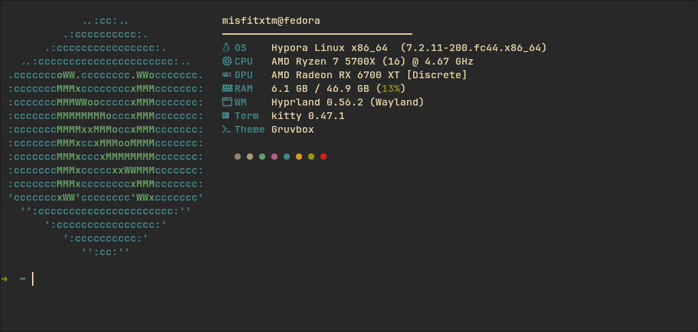

<p align="center">
  
</p>

<h1 align="center">Hypora</h1>

<p align="center">A privacy-focused Hyprland desktop for Fedora.</p>

<p align="center">
  
</p>

Hypora is installed with a single post-install script on top of a stock Fedora install (no custom ISO). The shell is built on [Quickshell](https://quickshell.org): a custom bar, control center, notification daemon and polkit prompt, all themeable from one palette file.

The aim is an "install it and it just looks good" experience that doesn't take control away from you: a small, readable codebase of plain shell scripts and QML with no framework on top, one place to change colours, and AI tooling that is offered but never assumed.

> **Alpha.** Most of it works and has run on real hardware, but some parts are unfinished and there are known bugs. See [what is incomplete](docs/reference.md#alpha-whats-incomplete), and please [report what you find](#reporting-bugs).

## Screenshots

All shown in **Nord**; every theme drives the same widgets from its own palette.

<p>


</p>


More in the [reference](docs/reference.md#screenshots).

## Requirements

Built and tested on **Fedora 44**, installed from the **Everything netinstall** with **"Encrypt my data"** ticked and **btrfs** as the filesystem. You also need an internet connection and a user with `sudo`.

None of those three install choices is enforced, but skipping encryption or btrfs can't be fixed later without reinstalling. Full details: [Requirements](docs/reference.md#requirements).

## Install

Either way, the files go in `~/.local/share/hypora` and `./install.sh` does the rest.

**A release**: a fixed set of files that was tested together, best if you want to say which Hypora you are reporting a bug against.

```bash
mkdir -p ~/.local/share/hypora
curl -fsSL https://github.com/misfitxtm/Hypora/archive/refs/tags/v0.1.0-alpha.tar.gz \
  | tar xz --strip-components=1 -C ~/.local/share/hypora
cd ~/.local/share/hypora
./install.sh
```

**The repository**: tracks `main`, so you get fixes as they land.

```bash
git clone https://github.com/misfitxtm/Hypora.git ~/.local/share/hypora
cd ~/.local/share/hypora
./install.sh
```

The installer is safe to re-run, and saves anything it replaces as `<name>.bak.<timestamp>`. Pick a theme with `THEME=TokyoNight ./install.sh`. What it does step by step, and how to update: [Installing in detail](docs/reference.md#installing-in-detail).

Reboot when it finishes. SDDM shows the Hypora login screen and starts the **Hyprland (uwsm-managed)** session. No login screen? Start it from a text console with `uwsm start hyprland-uwsm.desktop`.

## What you get

- **Hyprland** (started through `uwsm`) with **Quickshell** as the shell: bar, menu, control center, launcher, notifications and a polkit prompt. It replaces Waybar, Mako and a standalone polkit agent
- **Six themes**: Nord, Tokyo Night, Catppuccin Mocha, Gruvbox, Kanagawa and Osaka Jade, each with wallpapers. One `colors.toml` per theme drives everything, and **SUPER + ALT + T** switches ([make your own](docs/theming.md))
- **Settings windows** for Network, Bluetooth, Sound, Display, Default Apps, and Security & Privacy
- **Privacy and security by default**: DNS-over-TLS where the network allows it, a closed firewall, MAC randomization, automatic security updates and no telemetry ([details](docs/security.md))
- **Plugins** for the bar, with every file and script shown to you before anything is installed ([plugins](docs/plugins.md))
- **Terminal tools**: kitty, zsh with Oh My Zsh, eza, Neovim with LazyVim, and fastfetch

Everything, component by component: [What you get](docs/reference.md#what-you-get).

## Keys

| Keys | Action |
|---|---|
| SUPER + Enter | Terminal |
| SUPER + R | App launcher |
| SUPER + A | Hypora menu |
| SUPER + ALT + T | Theme picker |
| SUPER + L | Lock |
| SUPER + Q | Close window |
| SUPER + 1-0 | Switch workspace |

Every shortcut can be rebound from **menu > Help > Keybindings**. The full list: [Keybindings](docs/reference.md#keybindings).

## Documentation

The reasoning behind each subsystem (what it does, why it is done that way, and what the trade-offs are) lives in `docs/`:

| Document | Covers |
|---|---|
| [Reference](docs/reference.md) | Requirements, installing in detail, every component, keybindings, repository layout |
| [Security and privacy](docs/security.md) | What privacy means here, the Security window, where software comes from, the keyring, firmware and updates |
| [Boot](docs/boot.md) | The GRUB menu, the Plymouth splash and the themed text console |
| [Storage](docs/storage.md) | btrfs snapshots with snapper, and why Hypora would rather you had no swap partition |
| [Network](docs/network.md) | DNS-over-TLS where the network allows it, and per-network MAC randomization |
| [Power](docs/power.md) | Measuring what a laptop draws, and the profiles that reduce it |
| [Hardware](docs/hardware.md) | Finding hardware that came up without a driver, firmware or radio |
| [Desktop](docs/desktop.md) | Workspaces and monitors, the main display, customizing, and replacing another desktop |
| [Plugins](docs/plugins.md) | Installing a plugin, what you are agreeing to, and writing one |
| [Making a theme](docs/theming.md) | The 31 palette keys, the contrast checker, wallpapers, and adding a template |

## Known limitations

- Hyprland comes from a third-party COPR, so builds can lag behind or break after Fedora updates
- The Hyprland config is Lua, which is new. If something misbehaves after an update, check `hyprctl configerrors`
- LocalSend fails with "No route to host" until a network is in the `home` firewall zone ([the fix](docs/security.md#known-limitations))
- Only Fedora 44 has been tested

More: [Known limitations](docs/reference.md#known-limitations).

## Reporting bugs

File bugs and feature requests as [GitHub issues](https://github.com/misfitxtm/Hypora/issues); the menu's **Help > Report a bug** opens the form. A useful report says which Fedora version you run and whether it is bare metal or a VM, and includes `hyprctl configerrors` for compositor or keybind problems, the output of `qs` run from a terminal for shell problems, or `hypora-security status` for the Security window. The full checklist: [what to include](docs/reference.md#reporting-bugs-what-to-include).

## License

See [LICENSE](LICENSE).

## A note on AI assistance

The code here was written and reviewed by me, with help from [Claude Code](https://claude.com/claude-code). I decide what gets built and why, read every change before it lands, and test it on real hardware.

Either way, read the code rather than trust it. This is a desktop that configures your firewall, your DNS, your firmware updates and a helper that runs as root; the installer is plain shell and the shell layer is plain QML, both commented to explain *why* rather than *what*, specifically so that reading them is practical.
